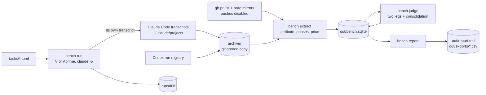

# harness-bench

A Python CLI that measures what my custom Claude Code setup costs and buys, against stock Claude Code, by mining my own session transcripts and by replaying past pull requests under each setup.

**Status: work in progress.** This is an early-stage project. Transcript mining, cost and attention measurement, the replay runner and the blinded judge have code and tests, and the stock arm has run end to end on a one-file smoke task. There is no comparison on real work yet. The stock and inline arms have not replayed a real pull request, and nobody has checked a judge finding by hand.

## What it is

I work with Claude Code through a harness of my own. It has a global `CLAUDE.md`, skills, subagents, hooks, and review legs that run on a second vendor's models. A feature goes through a grilling session, a spec, a plan, a plan review, execution and a PR review with several legs. That is a lot of machinery. I wanted numbers on whether it pays for itself instead of a feeling.

The bench compares three ways of working, called arms:

| arm | what runs | where its data comes from |
| --- | --- | --- |
| A | the full spec pipeline | mined from transcripts of real work |
| A′, `Aprime` in the CLI | the harness loaded, task done inline with no grill, spec or plan | mined, and replayable on demand |
| V | stock Claude Code with no user `CLAUDE.md`, skills, agents, hooks or second vendor | replayed on demand only |

Each merged pull request in a target repo becomes one record. A record carries cost at list price per model and per phase, wall clock, human turns, an attention estimate, findings raised and confirmed by the pipeline's own reviews, and findings from a blinded judge that reads the final diff. The first question it is built to answer is "keep the whole architecture or drop it", and the second is "what does the spec stage buy".

It fits one person's harness and repos. The code is general, but the A′ arm loads my real `~/.claude`, and the judge's second leg calls a wrapper script that lives in that harness, not here.

## What works today

- **Mining history into records.** `bench extract` archives every transcript under `~/.claude/projects/` for the configured repos, attributes sessions to merged PRs, segments phases, prices tokens and upserts records into SQLite. Tests: `tests/test_transcripts.py`, `test_attribute.py`, `test_phases.py`, `test_price.py`, `test_extract.py`.
- **A model pass for leftovers.** `bench extract --model-pass` sends sessions no rule could attribute to an isolated Opus call that returns a PR number or "none". Test: `tests/test_modelpass.py`.
- **Caught-in-process findings.** `bench extract --caught --record ID` mines the findings each review wave raised and the main session confirmed. Test: `tests/test_caught.py`.
- **Replayable tasks.** `bench tasks add` builds a task from a merged PR, either the whole PR with a hand-written ask or one numbered task from a plan file. Test: `tests/test_tasks.py`.
- **The runner.** `bench run --arm V|Aprime --task T` replays a task in an isolated checkout, resumes with a fixed stand-in reply until the model says DONE, stops a stalled run after three resumes with no change, and runs the PR's own tests as a gate. The two committed smoke runs, `runs/tiny-V-20260924164948/` and `runs/tiny-V-20260925112004/`, both ended `done` with the test gate passing, at $0.05 and $0.06 list price. Test: `tests/test_run.py`.
- **The blinded judge.** `bench judge --record ID` runs an Opus reviewer leg and a second-vendor leg on the stripped diff, then one consolidation pass that tags each finding `blocker`, `major`, `minor` or `not-a-defect`. Test: `tests/test_judge.py`.
- **The report.** `bench report` writes `out/report.md` and CSV exports with pool sizes, a headline table per arm and size stratum, cost per phase, caught findings, runs, coverage and the validity limits. [`docs/readme/sample-report.md`](docs/readme/sample-report.md) is a synthetic sample of its shape. Test: `tests/test_report.py`.
- **A nightly schedule that spends no model usage.** `bin/install-launchd.sh` installs a launchd agent that runs extract and report at 03:30 into the gitignored `out/`.

What it has shown so far is thin. On 2026-11-12 the store held 59 mined records in the loosened pool and 26 in the strict one, from two of my repos. In mined A records, execution took 42 percent of list-price cost, and plan review and PR review took 20 percent each. Those numbers come from the private store, not from this repo, and they say nothing yet about V, which has only run the smoke task.

### Next

From the design spec's shortlist and its out-of-scope list:

1. Run V and A′ on the shortlisted tasks, three whole PRs and two plan slices, each under about 1,500 reference lines.
2. Judge the history records once each has a hand-written ask, and hand-verify a sample of findings so the report can state the judge's precision.
3. Price the second-vendor review legs, which are logged at zero today because the wrapper records tokens only under `exec --json`.
4. Ablation arms that switch off one stage at a time: no plan review, no PR review, no model routing.

## Run it

Not run here: these commands come from the repo's own docs and tests and were not executed for this README.

| fact | value |
| --- | --- |
| Runtime | Python 3.12, pinned to `>=3.12,<3.13` in `pyproject.toml` |
| Package manager | [uv](https://docs.astral.sh/uv/), with `uv.lock` committed |
| Operating system | macOS. Run checkouts are hard-coded to `/Users/Shared/harness-bench/worktrees`, and the schedule uses launchd |
| External tools | Claude Code CLI, logged in. GitHub CLI `gh`, authenticated, for PR metadata. `git` |
| Paid keys | No API keys. `run`, `judge`, `--model-pass` and `--caught` spend Claude Code subscription usage, and the judge's second leg also spends Codex usage |
| Ports | None |
| Time to first run | Not measured |

1. Clone and install.

```sh
git clone https://github.com/kevinshibuya/harness-bench.git
cd harness-bench
uv sync
```

Expect: uv creates `.venv/` and installs `pandas` and `pytest`.

2. List your target repos.

```sh
cp config/repos.example.toml config/repos.local.toml
```

Expect: `config/repos.local.toml` exists. Edit it to point at your own repos, each with its integration branch and test command. It is gitignored.

3. Mine and report. This spends no model usage.

```sh
uv run bench extract
uv run bench report
uv run bench status
```

Expect: `out/bench.sqlite`, `out/report.md` and `out/exports/*.csv` exist, and `status` prints pool sizes and coverage.

4. Build the smoke repo and log the empty config directory in once.

```sh
scripts/make-tiny-repo.sh
CLAUDE_CONFIG_DIR="$PWD/config/empty-claude" claude auth login
```

Expect: `mirrors/tiny-src/` holds a two-file repo whose one test fails, and the login completes for `config/empty-claude/`.

5. Print the first call of a V run without spending anything, then run it.

```sh
uv run bench run --arm V --task tiny --dry-run
uv run bench run --arm V --task tiny
```

Expect: the dry run prints the `claude -p` call, and the real run ends `done` with the test gate passing and writes `runs/<run id>/`.

6. Install the nightly job.

```sh
bin/install-launchd.sh
```

Expect: `install-launchd: loaded com.kevin.harness-bench`. Remove it with `bin/install-launchd.sh --remove`.

### Check it works

```sh
uv run pytest
```

Expect: a summary line ending in `passed`, with no failures.

### Environment variables

The bench reads none of its own. One is used once, by hand:

| name | required or optional | what it does | how to get a value |
| --- | --- | --- | --- |
| `CLAUDE_CONFIG_DIR` | required for step 4 only | points the Claude Code login at the bench's empty config directory | `"$PWD/config/empty-claude"` |

### If it fails

- **The isolation check refuses a V run.** The reply carried text from the global `~/.claude/CLAUDE.md`. Keep run checkouts outside `$HOME`, because Claude Code reads `.claude/CLAUDE.md` in every ancestor of the working directory.
- **A model is skipped with a pricing warning.** `config/prices.toml` has no row for it. Add the vendor's list price with its fetch date.
- **`bench judge` refuses a history record.** The record has no hand-written ask. Add one with `bench tasks add --repo R --pr N --ask "…"`.

For agents, there is no `CLAUDE.md` or `AGENTS.md` in this repo. The working rules are the design spec and plan under `docs/`.

## How it's built



| Path | What lives there |
| --- | --- |
| `bench/` | The package, with transcript reader, attribution, phases, pricing, store, runner, judge, report, CLI |
| `bench/schema.sql` | The SQLite schema for records, phases, runs, judgements and findings |
| `config/arms/` | One TOML per arm: model, effort, isolation, prompt prefix |
| `config/prices.toml` | List prices per model with the date each was fetched |
| `config/repos.example.toml` | Template for the gitignored `config/repos.local.toml` |
| `prompts/` | Fixed prompts for the judge, consolidation, model pass, caught findings, stand-in reply, run suffix |
| `tasks/` | Replayable tasks and the cached `/init` `CLAUDE.md` per repo |
| `runs/` | Per-run JSON results and final diffs, today the two smoke runs |
| `bin/` | The nightly job and its launchd installer |
| `docs/` | Design spec, implementation plan, synthetic sample report |

## Why it's built this way

**Mine the expensive arm, replay only the cheap ones.**
Rerunning the full spec pipeline per task would cost hours of my attention as well as model usage, so A comes only from transcripts of work that happened anyway. V and A′ are replayed on demand, and nothing that spends model usage runs on a schedule. The cost is that A has one sample per PR and its tasks were chosen by real life, not by the bench; the report shows n in every cell. ([spec §2](docs/specs/2026-09-24-harness-bench-design.md#2-what-is-mined-and-what-is-run))

**V runs in an empty config directory and in a checkout outside `$HOME`.**
The first live V run passed the original isolation check, yet its reply began with the first line of my global `CLAUDE.md`. Claude Code reads `.claude/CLAUDE.md` in every ancestor of the working directory, and `$HOME` was an ancestor of the checkout. Checkouts moved to `/Users/Shared/harness-bench/worktrees`, the check now also rejects that first line and the `## Lanes` heading, and the contaminated runs were purged. `--bare` was rejected because it reads only an API key, never the subscription login, and hides every `CLAUDE.md`. ([spec §6](docs/specs/2026-09-24-harness-bench-design.md#6-vanilla-run-protocol), commit `569a983`)

**A′ is pinned to the exact model id V uses.**
Until 2026-09-25 A′ used whatever the harness's default model alias resolved to, and in September alone that alias moved from `fable` to `opus` to `opus[1m]` and back to `opus`. V was pinned to `claude-opus-5-5`, so the two arms would have drifted apart without anyone changing the bench. Both now run `claude-opus-5-5` for the main session; what the harness dispatches still runs on the models the harness picks, because that is the arm. ([spec §7 amendment](docs/specs/2026-09-24-harness-bench-design.md#7-inline-a-run-protocol), [`config/arms/`](config/arms/))

**A whole-PR task's ask is written by hand, not mined.**
The rule was to replay the first human turn of the PR. For the three whole PRs on the shortlist that turn was a status question, a go-ahead on an earlier answer and a request to pick up a handoff file, because the grilling had happened in an earlier session no rule attributed. None of them is a replayable ask, so `bench tasks add --ask` takes one written by me, and the mined turn stays on the record as provenance. ([spec §9 amendment](docs/specs/2026-09-24-harness-bench-design.md#9-tasks))

**Sessions can be excluded by hand, with a written reason.**
Attribution rule 1 gives a session to the PR whose branch it ran on. One session ran on a feature branch in a target repo but was the grilling and planning of this bench, so that PR carried the bench's design cost and 46 review findings about it. A scan of every archived session in both repos found no other case, and nothing scans for the next one, so `exclude_sessions` in the repos config drops a session before attribution and the report counts exclusions in their own column. ([spec §5 amendment](docs/specs/2026-09-24-harness-bench-design.md#5-attribution-and-phases))

**The judge strips anything that names the arm.**
Specs, plans and an injected `CLAUDE.md` give the arm away on sight, so the judged diff drops `docs/`, `CLAUDE.md`, `CONTEXT.md`, `HANDOFF*.md` and `.claude/` for every arm, along with commit messages and branch names. The report states the cost as a validity limit. A task whose deliverable was documentation gets judged on its code only. ([spec §8](docs/specs/2026-09-24-harness-bench-design.md#8-judge))

**Output is gitignored and the nightly job never commits.**
The store began as `results/`, committed nightly and pushed. It holds verbatim prompts and details of private target repos, which cannot sit in a public repo, so everything the bench generates now goes to `out/`, and `bin/nightly.sh` refuses to run if `out/` is not ignored. The cost is that results no longer travel with the code. ([spec §11 amendment](docs/specs/2026-09-24-harness-bench-design.md#11-build))

## How it was made

The design was grilled into a spec, turned into a 16-task plan, reviewed, and built task by task in gated Claude Code sessions, with each PR reviewed by me before merge. The spec and plan, with their dated amendments, are in [`docs/specs`](docs/specs/) and [`docs/plans`](docs/plans/).

## Credits and licence

Dependencies are [pandas](https://pandas.pydata.org/), BSD 3-Clause, and for tests [pytest](https://pytest.org/), MIT.

MIT. Copyright (c) 2026 Kevin Shibuya. See [`LICENSE`](LICENSE).
